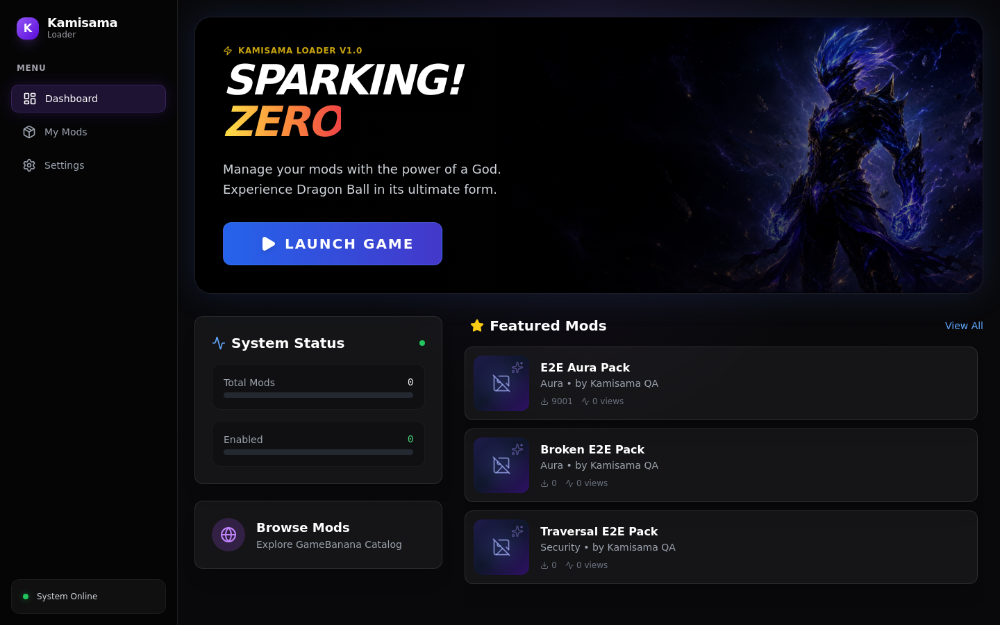
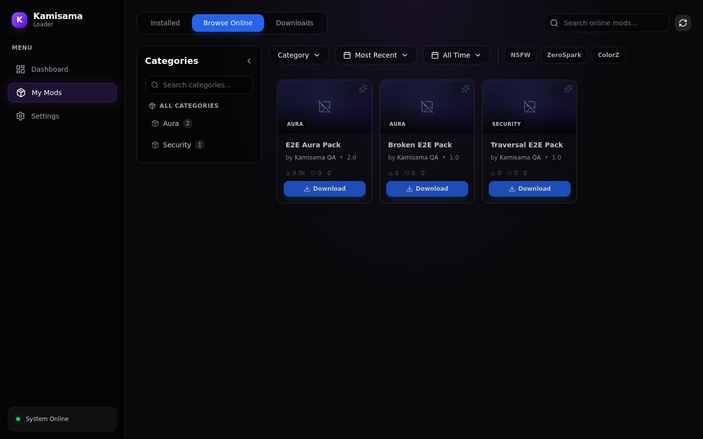
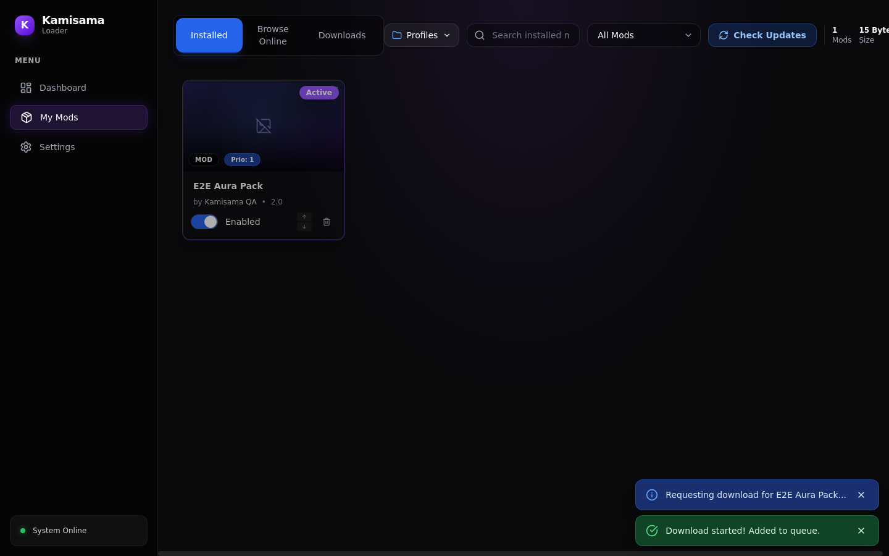
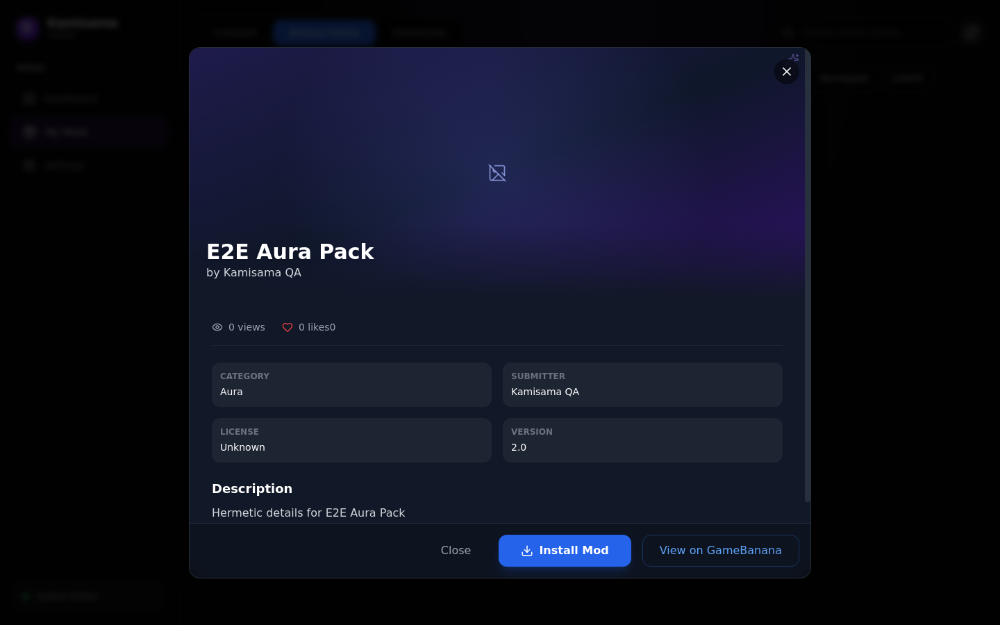
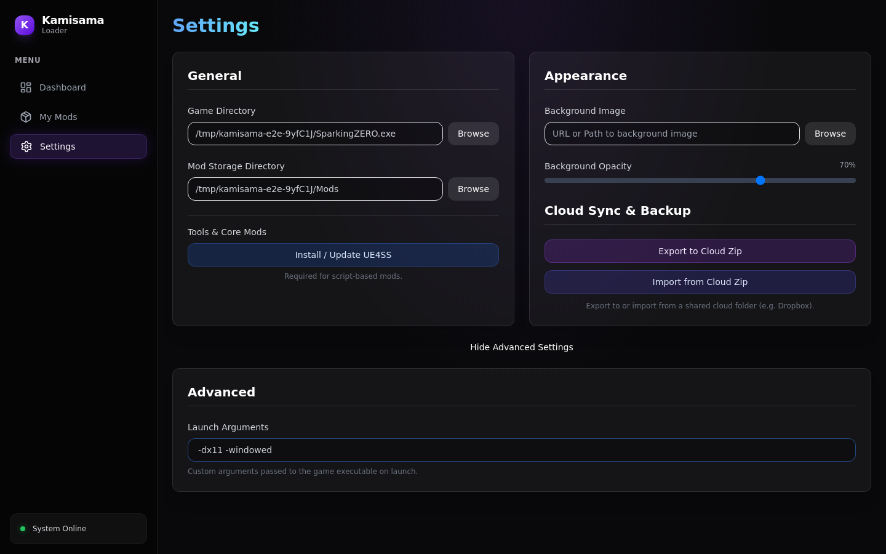
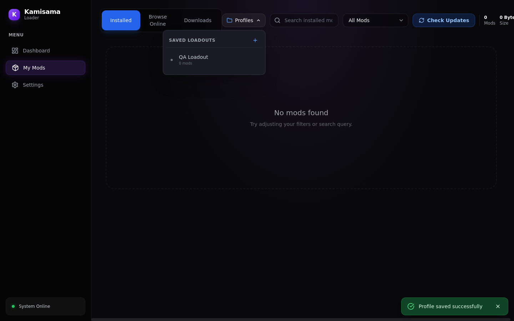
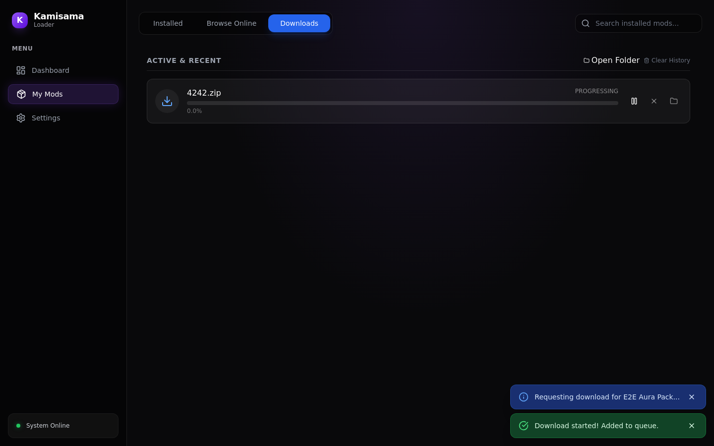
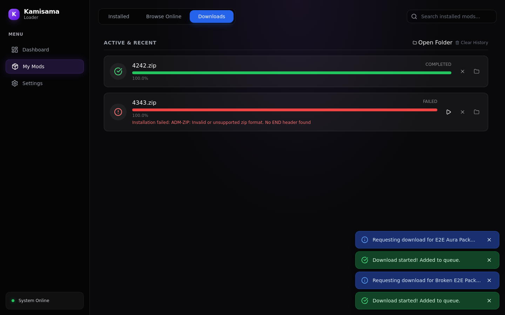
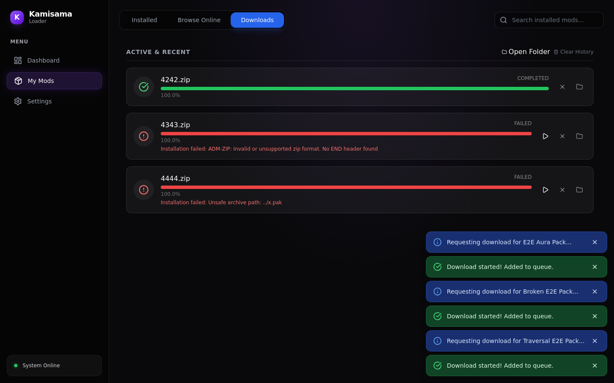
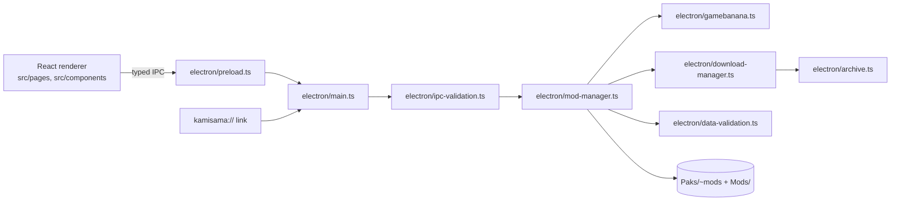

<div align="center">



# 🐉 Kamisama Mod Loader

**A premium Mod Loader for Dragon Ball: Sparking! ZERO, built for speed, reliability, and a stunning user experience.**<br/>
Install a mod from GameBanana in one click, toggle it on or off, and set its load priority without touching the game folder.

[](https://github.com/juninmd/KamisamaLoader/releases/latest)
[](https://github.com/juninmd/KamisamaLoader/actions/workflows/validate.yml)
[](https://www.electronjs.org/)
[](https://reactjs.org/)
[](https://vitejs.dev/)
[](https://tailwindcss.com/)

</div>

> Manage every mod for **Dragon Ball: Sparking! ZERO** from one window: browse the GameBanana catalog, install with a click
> (or a `kamisama://` link), and keep your library, profiles and load order consistent.

## ✨ Features

- **One-Click Installation**: Seamlessly install mods using custom protocols (`kamisama://`, `gb-modmanager://`).
- **Mod Management**: Enable, disable, and organize your mod library with ease.
- **Glassmorphism UI**: A modern, responsive interface built with React 19 and Framer Motion.
- **Strict Separation**: Clean architecture separating UI (Renderer) from heavy I/O (Main Process).
- **Data Integrity**: Automated validation for `mods.json` and profiles to prevent corruption.

Also in the app: load priority per mod, named profiles (loadouts), update checks, a download queue with pause and resume,
UE4SS install for script-based mods, and export or import of settings as a zip for a shared cloud folder.

## 🖼️ Tour

<table>
<tr>
<td width="50%"><br/><b>Browse Online</b> &ndash; GameBanana catalog with categories, sort, date and content filters.</td>
<td width="50%"><br/><b>My Mods</b> &ndash; enable switch, priority arrows and uninstall per mod.</td>
</tr>
<tr>
<td width="50%"><br/><b>Mod details</b> &ndash; category, version and description before you install.</td>
<td width="50%"><br/><b>Settings</b> &ndash; game paths, UE4SS, background, cloud sync zip and launch arguments.</td>
</tr>
</table>

<details>
<summary>🖥️ More screens: profiles, downloads, rejected archives</summary>

| Profiles | Download in progress |
|---|---|
|  |  |

| Corrupt zip rejected | Path traversal rejected |
|---|---|
|  |  |

</details>

<sub>Screenshots come from the Playwright end-to-end run against a local fixture of the GameBanana API; mod names and paths are fictitious.</sub>

## 🛠️ Tech Stack

- **Framework**: Electron + Vite
- **Frontend**: React 19 + TypeScript
- **Styling**: TailwindCSS + Framer Motion
- **I/O**: adm-zip for fast mod extraction
- **Testing**: Vitest (Unit) + Playwright (E2E)

## 📦 Install

Download the AppImage from the [latest release](https://github.com/juninmd/KamisamaLoader/releases/latest)
(`Kamisama.Mod.Loader-<version>.AppImage`).

> [!NOTE]
> Releases currently ship a Linux AppImage only. On Windows, build the NSIS installer from source with `pnpm run dist` (see Develop).

## 🚀 Quick Start

```bash
# Install dependencies
pnpm install

# Run development environment
pnpm run dev

# Build for distribution
pnpm run dist
```

Then open **Settings**, pick the game executable (`SparkingZERO.exe`) and a mod storage folder.

## 🧭 How it works



- The renderer never touches `fs`; every file operation goes through a validated IPC handler in the main process.
- Enabling a mod deploys its `.pak`, `.sig`, `.utoc` and `.ucas` files to `SparkingZERO/Content/Paks/~mods` with a priority prefix (`000_...`); disabling removes them and updates `mods.json`.
- Settings, local mods, profiles and caches are parsed by `electron/data-validation.ts` before use.

## ⚙️ Configuration

Set in **Settings**; stored by the app in its user data folder.

| Setting | Purpose | Required / default | Example |
|---|---|---|---|
| Game Directory | path to the game executable, used to find `SparkingZERO/Content/Paks/~mods` | required | `C:\Games\SparkingZERO\SparkingZERO.exe` |
| Mod Storage Directory | where downloaded mods are kept (`Mods/<name>/`) | required | `D:\Mods` |
| Launch Arguments | extra arguments passed to the game on launch | optional | `-dx11 -windowed` |
| Background Image / Opacity | custom app background, URL or path | optional | `70%` |

## 🧑‍💻 Develop

```bash
pnpm install            # dependencies
pnpm run dev            # Vite + Electron with hot reload (Vite on port 5173)
pnpm run lint           # eslint
pnpm run type-check     # tsc --noEmit
pnpm run test:unit      # Vitest unit tests
pnpm run test:coverage  # unit tests with coverage
pnpm run test:e2e       # build, then Playwright end-to-end run (writes tests/evidence/homologation)
pnpm run build          # type-check, Vite build and Electron compile
pnpm run dist           # build + electron-builder (NSIS on Windows, AppImage on Linux)
```

## 🛡️ Antigravity Protocol

This project follows the **Antigravity** engineering standards, defined in [`AGENTS.md`](AGENTS.md):
- **150-Line Limit**: Modular code structure for maximum maintainability. *Not yet met everywhere, see Known limitations.*
- **Strict Types**: Full TypeScript coverage, `any` to be removed. *Not yet met everywhere, see Known limitations.*
- **Typed IPC**: All communication between processes is strictly typed and secure.

## 📚 Documentation

| Document | What's in it |
|---|---|
| 📋 [`docs/QA-HOMOLOGATION.md`](docs/QA-HOMOLOGATION.md) | manual QA checklist for install, enable, priority, profiles and online browsing |
| 🤖 [`AGENTS.md`](AGENTS.md) | engineering rules and AI personas |
| 🗺️ [`ROADMAP.md`](ROADMAP.md) | phases and what is still open |

## 🔒 Security

| Layer | Protection |
|---|---|
| Archives | `electron/archive.ts` rejects absolute paths, `..`, `:` and NUL in entry names, more than 50,000 entries, more than 4 GiB expanded and compression ratios above 1,000:1 |
| Renderer | `contextIsolation` on, `nodeIntegration` off, `sandbox` on; navigation limited to the app origin and `window.open` only hands `http(s)` links to the system browser |
| IPC | arguments checked by `electron/ipc-validation.ts` before reaching the mod manager |
| Data files | `mods.json`, profiles, settings and caches validated on read |

## ⚠️ Known limitations

- Releases ship only a Linux AppImage; Windows users build the installer themselves.
- The 150-line and zero-`any` rules are not met yet: `electron/mod-manager.ts` has 1,405 lines and about 36 `any` usages remain across `electron/`, `src/` and `shared/`.
- No `LICENSE` file is published, so no reuse terms are granted yet.
- Mod sources are GameBanana and GitHub (UE4SS) only.

## 📄 License

No license file is present in the repository yet.

---

*"Power comes in response to a need, not a desire."*
