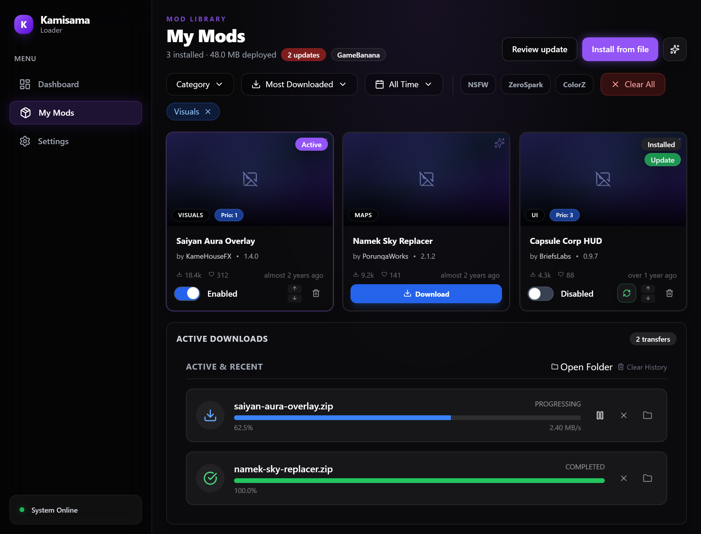
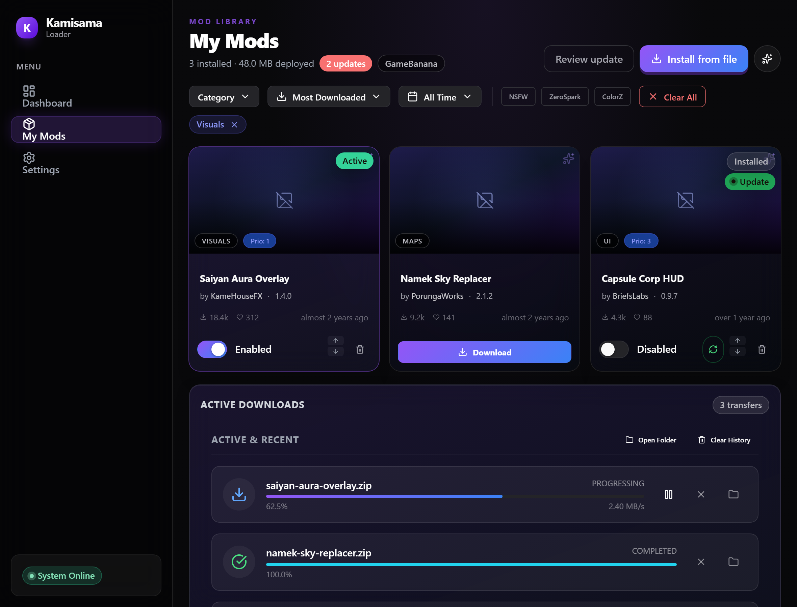

# Sonido design-system migration

KamisamaLoader now renders its shared UI with [`@juninmd/sonido@^2.5.0`](https://www.npmjs.com/package/@juninmd/sonido)
instead of the local copies of Button, Card, Badge, Skeleton, Switch, Toast and the two modal
shells. Business logic, IPC calls and the mod-domain widgets are unchanged.

| | Before | After |
| --- | --- | --- |
| Brand accent | violet `--primary`, but many widgets hard-coded `blue-600` | violet `--sn-color-accent` bridged from `--primary`; CTAs use the Sonido gradient |
| Surfaces | hand-written `glass-card` / `glass-panel` | Sonido `Card` glass surface over the same background |
| Dialog | portal + custom backdrop per modal | native `<dialog>` + `showModal()` from Sonido (`Esc`, focus trap, backdrop click) |
| Toasts | local component and timer | Sonido `ToastProvider`/`useToast`, same `showToast(message, type)` API |
| Tests | local class names / roles | Sonido roles (`switch`, `tab`, native `dialog`) |





## Components swapped

| Primitive | Sonido component | Where |
| --- | --- | --- |
| Button | `Button` (`size`, `appearance`, `press`, `loading`, `iconStart/iconEnd`) | `src/components/ui/Button.tsx` adapter; `src/layouts/MainLayout.tsx`, `src/pages/Dashboard.tsx`, `src/pages/Settings.tsx`, `src/pages/Mods.tsx`, `src/components/FilterBar.tsx`, `src/components/DownloadsList.tsx`, `src/components/ProfileManager.tsx`, `src/components/UpdateDialog.tsx`, `src/components/ModDetailsModal.tsx`, `src/components/mods/ModCard.tsx` |
| Card | `Card`, `CardHeader`, `CardTitle`, `CardBody`, `CardFooter` | `src/components/ui/Card.tsx` adapter; `Dashboard`, `Settings`, `ModCard`, `ModDetailsModal` |
| Badge | `Badge` (`tone`, `appearance`, `dot`, `live`, `count`) | `src/components/ui/Badge.tsx` adapter; `MainLayout`, `Dashboard`, `ModCard`, `FilterBar`, `CategorySidebar`, `ModDetailsModal`, `UpdateDialog` |
| Skeleton | `Skeleton` (`media`, `rows`, `label`) | `src/components/Skeleton.tsx`, `ModGrid` loading grid, `Dashboard` featured feed |
| Switch | `Switch` (`role="switch"`) | `src/components/ui/Switch.tsx` adapter; `ModCard` |
| Dialog | `Dialog` (native modal, footer slot) | `src/components/UpdateDialog.tsx`, `src/components/ModDetailsModal.tsx` |
| Toast | `ToastProvider` + `useToast` | `src/components/ToastContext.tsx` bridge (legacy `showToast` signature kept) |
| Tabs | `Tabs` (`variant="pill"`) | `src/pages/Mods.tsx` view switcher |
| Select | `Select` (`compact`, `hideLabel`) | `src/pages/Mods.tsx` installed-mod filter |
| SearchField | `SearchField` | `src/pages/Mods.tsx`, `src/components/CategorySidebar.tsx` |
| ProgressBar | `ProgressBar` | `src/components/DownloadsList.tsx`, `src/pages/Dashboard.tsx` |
| EmptyState | `EmptyState` | `src/components/mods/ModGrid.tsx`, `src/components/DownloadsList.tsx` |
| StatTile | `StatTile` | `src/pages/Dashboard.tsx` |
| Spinner | `Spinner` | `src/pages/Mods.tsx` infinite-scroll footer |
| Alert | `Alert` | `src/components/UpdateDialog.tsx` |

`src/components/Toast.tsx` was deleted; the provider now renders Sonido toasts.

## Theme bridge

`src/main.tsx` imports `@juninmd/sonido/styles.css` once, before `index.css`, and sets
`document.documentElement.dataset.theme = "kamisama"` (also present in `index.html`).
`src/index.css` maps every relevant `--sn-*` token to the existing Kamisama tokens:

```css
--sn-color-bg: hsl(var(--background));
--sn-color-surface: hsl(var(--card));
--sn-color-accent: hsl(var(--primary));
--sn-color-accent-2: #6366f1;
--sn-gradient: linear-gradient(135deg, hsl(var(--primary)), #3b82f6);
--sn-glass: rgb(12 12 24 / 0.6);
```

No Sonido theme (coral default, `light`, `dracula`, …) is activated, so the app keeps its own
violet accent, dark game skin and the `data-theme` attribute.

## Kept local (no generic equivalent)

- `src/components/Artwork.tsx` — Sonido `Artwork` has no `fallbackSrc` chain or labelled
  placeholder, both required by the mod covers and covered by tests. Kept as a domain widget.
- `FilterBar` dropdowns / boolean toggles — Sonido `FilterChips` is single-select; the catalog
  filter is multi-select with date/sort menus. The chips and triggers use Sonido `Badge` /
  `Button`, the routing logic stays local.
- `CategorySidebar` (favorites tree), `ProfileManager` (inline create form), `DownloadsList`
  rows, `TitleBar` (Electron window controls) and `ModGrid` layout — app/domain specific.

## Verification

Run on this working tree (`feat/sonido-design-system`, Windows 11, Node 24):

| Command | Result |
| --- | --- |
| `pnpm run lint` | 0 errors, 6 pre-existing `react-hooks/exhaustive-deps` warnings in `src/pages/Mods.tsx` |
| `pnpm run type-check` | pass |
| `pnpm run test:unit` | 134 files, **821 tests passed**, exit 0 |
| `pnpm run build` | pass (`tsc -b`, Vite 2428 modules, Electron `tsc`) |

`@juninmd/sonido@^2.5.0` was installed with pnpm; no `minimumReleaseAge` exclusion was needed
(no `minimum-release-age` configured), and `pnpm-lock.yaml` was updated by `pnpm add`.

### Two pre-existing failures found on `origin/master`

1. **Windows-only assertion.** `tests/unit/mod-manager-download-stream.test.ts` expects
   `/ENOTDIR/`, but Windows reports `ENOENT` when the parent path is a file. Proven in a detached
   `origin/master` worktree:

   ```
   AssertionError: expected [Function] to throw error matching /ENOTDIR/
   but got 'ENOENT: no such file or directory, open '...\\mod.zip''
   ```

   The test now accepts `ENOENT|ENOTDIR`; the behaviour under test (the download rejects instead
   of raising an uncaught exception) is unchanged.

2. **Unhandled `AbortError` teardown noise.** framer-motion animations cancelled during happy-dom
   unmount produced unhandled rejections on master (`Errors 100`), so `vitest` exited 1 even when
   all assertions passed. `tests/setup.ts` now renders `motion.*` as the underlying element in unit
   tests, which removes the animation-only failure without skipping assertions.

### Screenshots

Both images are 2360×1800 (1180×900 at `deviceScaleFactor: 2`, full page) of an **ephemeral**
harness built from the real app CSS and the real components. Fictitious mods/downloads only.

- `antes.png` — detached worktree at `origin/master`
  (`C:/Users/jr_ac/AppData/Local/Temp/opencode/before-KamisamaLoader`), Vite on port **5339**.
- `depois.png` — this branch, Vite on port **5329**.
- Captured with `node C:/Users/jr_ac/AppData/Local/Temp/opencode/shot/full.cjs "<url>" "<png>"`.
- The harness (`harness.html`, `src/harness/`) was deleted before committing; there is no
  `docs/sonido-migration/legacy/` folder and no committed `preview.*` file.

## Caveats

- Sonido ships a handful of pt-BR strings in its own components (dialog close button is announced
  as **"Fechar"**, toasts region as "Notificações"). Visible copy in KamisamaLoader stays English.
- Sonido `Badge` has no `info` tone (mapped to `violet`) and `Button` has no `outline` variant
  (mapped to `secondary` + `appearance="outline"`).
- The `Card` adapter forwards `ref` through Sonido's card in React 19; Sonido's internal tilt ref
  is replaced when a consumer ref is supplied, so `tilt` is not used together with a ref.
- Coverage thresholds were not re-baselined in this PR; `pnpm run test:coverage` was not part of
  the acceptance run.
